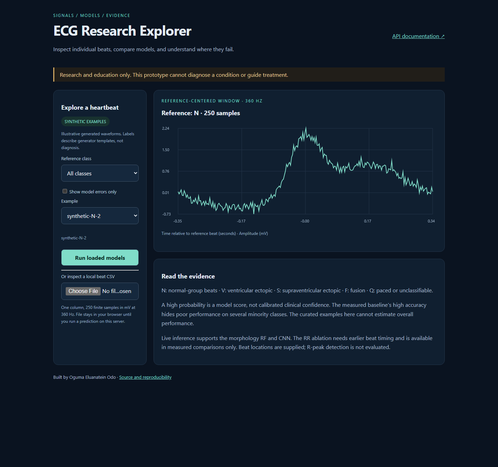

# ECG Arrhythmia Detection

I built this project to study how ECG beat classifiers generalize to people they have not seen during training. I use the MIT-BIH Arrhythmia Database, a morphology-based Random Forest baseline, and a compact PyTorch CNN, with a FastAPI service for inference.

My focus is reproducible evaluation: keeping patients separate, reporting minority-class failures, and making the data and model assumptions visible.

**Research and education only. This is not a medical device or a tool for clinical decisions.**

## What this project provides

I built a research baseline for comparing ECG beat classifiers on unseen patients,
an explorer for inspecting waveforms and model errors, and an API prototype for
integrating already segmented beats into an application.

The practical value is reproducible experimentation and transparent error analysis.
It does not provide patient screening, continuous ECG monitoring or clinical diagnosis.
See my [model card](MODEL_CARD.md) for the intended users and limits.

## Explore the project



Run `uvicorn api.main:app --reload` and open
`http://localhost:8000/explorer`. The explorer works offline with labeled synthetic
fixtures. Point `ECG_MODEL_DIR` at a completed research bundle to browse curated
held-out MIT-BIH examples, compare reference/model labels and filter errors.
You can also inspect a local 250-sample CSV and request predictions from loaded models.

## Reproducible research suite

```bash
python -m src.eval.research_suite --download --epochs 10 --bootstrap 200
```

I compare a morphology RF, a morphology-plus-RR RF, and a CNN using the same outer
patient split. CNN epoch selection uses validation subjects from training patients
only, followed by refitting. Reports include per-class scores, patient-bootstrap
intervals, training time, inference throughput, data hashes and model bundles.

I also provide frozen-model noise evaluation on NSTDB, excluding overlapping clean
source patients, and external evaluation on all 75 INCART records with explicit
lead selection and resampling. These are research checks, not clinical validation.

See the [experiment guide](docs/experiments.md) for the fixed environment, complete
commands and reporting assumptions, and [release instructions](docs/releasing.md)
for artifact verification. The historical RF results below remain separately identified.

## What I have measured

[Full evaluation run](https://github.com/eluan216/ecg-arrhythmia-detection/actions/runs/42090136918)
· [Measured report](reports/mitbih/2026-11-05/full_report.json)
· [Patient split](reports/mitbih/2026-11-05/patient_split.json).

All **45 included records** were loaded: **102,941 accepted beats** in total.
Training uses 82,007 beats from 35 subjects (36 records); the held-out test set
uses 20,934 beats from 9 different subjects (9 records). Records 201 and 202
remain together in training. This is the repository's custom seed-42 split,
not the fixed DS1/DS2 split used in some publications.

The dataset has 48 records; this protocol excludes 102, 104, and 107 and
retains 217. These results therefore describe the full **45-record protocol**,
not an evaluation of all 48 records. Each input is a 250-sample window centered
on a reference annotation, using channel 0 at 360 Hz. Beat localization is
provided by the dataset annotations; this does not measure R-peak detection.

| Model | Macro-F1 | Weighted-F1 | Accuracy | 5-fold GroupKFold macro-F1 |
|-------|----------|-------------|----------|----------------------------|
| Random Forest (200 trees) | 35.83% | 94.96% | **94.79%** | 28.61% ± 4.02 percentage points |
| 1D-CNN (raw windows) | *run `--from-patient-split` to measure* | — | — | — |

The model and seed were fixed before this run. Cross-validation uses training
subjects only; the held-out set was used for final reporting, not model selection.
Macro-F1 always averages all five declared classes, including zero-F1 classes.

| Class | Precision | Recall | F1 | Test beats |
|-------|-----------|--------|----|------------|
| N | 96.90% | 97.48% | 97.19% | 19,032 |
| V | 87.40% | 75.97% | 81.29% | 1,698 |
| S | 0.91% | 0.52% | 0.66% | 193 |
| F | 0.00% | 0.00% | 0.00% | 7 |
| Q | 0.00% | 0.00% | 0.00% | 4 |

**Interpretation:** high overall accuracy is dominated by normal beats
(19,032 of 20,934 test beats). The model performs poorly on supraventricular
beats and misses the rare F/Q test examples. It is not a reliable five-class
classifier on unseen patients. F/Q estimates are especially unstable because
their test supports are only 7 and 4.

Largest confusions: V→N (394), N→Q (189), S→N (188), N→V (182), and N→S (109).
The full report includes the complete confusion matrix in class order N/V/S/F/Q,
per-class metrics, file SHA-256 hashes, source commit, and package versions.


## Run it locally

I use Python 3.11 for the commands below. CI also covers Python 3.9 and 3.10.

```bash
git clone https://github.com/eluan216/ecg-arrhythmia-detection.git
cd ecg-arrhythmia-detection
python -m venv .venv
# macOS/Linux:
source .venv/bin/activate
# Windows PowerShell: .venv\Scripts\Activate.ps1
python -m pip install -e ".[dev]"
pytest tests/ -q
```

For a quick offline demonstration:

```bash
python -m src.pipeline.benchmark
```

I use synthetic data for smoke tests only. Its scores are not evidence of performance on real ECGs.

## Reproduce my real-data baseline

```bash
python -m src.eval.full_mitbih
```

This downloads the 45 records in my declared protocol, checks the required files, and trains a 200-tree Random Forest. It writes the model, patient split, metrics, data hashes and package versions to `artifacts/full-mitbih/`. Missing or unreadable required records stop evaluation.

My protocol uses:

- Five classes in order **N, V, S, F, Q**, with an explicit beat-symbol whitelist.
- A custom subject-level 80/20 split with seed 42; records 201 and 202 stay together.
- Five-fold GroupKFold on training subjects only.
- Channel 0 at 360 Hz, with 250-sample windows centered on reference beat annotations.
- Fifteen shared morphology features for training and baseline inference.
- Exclusions 102, 104 and 107; record 217 is retained.

I keep this cohort unchanged so the checked-in results remain interpretable. It differs from commonly used 44-record protocols and fixed DS1/DS2 partitions. Channel 0 is not always MLII; record 114 has reversed signal order. I do not claim direct comparability to papers using other lead or exclusion policies.

For the lower-level evaluation entry point:

```bash
python -m src.data.download
python -m src.eval.inter_patient
```

This writes to `artifacts/eval/`.

## Train the CNN on the same patient split

```bash
python -m src.data.download
python -m src.train.train_cnn \
  --from-patient-split reports/mitbih/2026-11-05/patient_split.json \
  --output-dir models/cnn_interpatient \
  --epochs 50
```

I use per-beat z-score normalization in both training and inference. Training now uses a fixed final epoch and evaluates the test set once after training; it does not choose checkpoints using test scores. Macro-F1 includes all five classes, including classes absent from a particular test batch or cohort.

Earlier CNN training code selected a checkpoint using the test set; metrics from that path require a fresh run. The new research suite uses a separate training-subject validation partition. Its results are documented separately from the historical RF table.

## Serve a trained model

Start the API after generating a model:

```bash
# macOS/Linux
ECG_MODEL_DIR=artifacts/full-mitbih uvicorn api.main:app --reload
```

```powershell
$env:ECG_MODEL_DIR = "artifacts/full-mitbih"
uvicorn api.main:app --reload
```

Open `http://localhost:8000/docs`. POST `/predict` accepts:

```json
{"signal": [0.1, 0.2], "sampling_rate": 360, "model": "auto"}
```

The two values above illustrate the JSON structure; a valid request needs **32–1000 finite samples**. For results comparable to my benchmark, provide a **250-sample reference-centered beat in physical signal units at 360 Hz**. The service does not locate beats or resample recordings. Other accepted lengths are outside my measured protocol.

`model` can be `auto`, `baseline`, or `cnn`; automatic selection prefers the baseline. `/health` checks liveness and `/ready` returns 503 until a model is available. Set `ECG_MODEL_DIR` to the directory containing `baseline_model.pkl` or `cnn_model.pth`. Load only trusted local model files, using compatible training dependencies.

For Docker, mount your model directory explicitly:

```bash
docker build -t ecg-arrhythmia-api .
docker run --rm -p 8000:8000 \
  -v "${PWD}/artifacts/full-mitbih:/models:ro" \
  -e ECG_MODEL_DIR=/models ecg-arrhythmia-api
```

The image contains application code; model artifacts are supplied at runtime.
It installs the same pinned CPU scientific environment used by the research workflow.

To exercise the API with one of the explorer examples:

```bash
python examples/predict.py
```

The client reports whether the source is synthetic or measured and fails clearly
when no model is loaded.

## Remaining research questions

My historical baseline struggles with S, F and Q. The new suite tests rhythm context,
CNN comparison, uncertainty and robustness explicitly. Whether these changes improve
performance must be established by measured reports.

Independent prospective validation, calibration, subgroup analysis and end-to-end
beat detection remain future work. The existing holdout has informed development,
so it is a development benchmark. I do not claim clinical readiness.

## Repository guide

| Path | Purpose |
| --- | --- |
| `src/data/` | Downloading, segmentation, shared preprocessing and synthetic fixtures |
| `src/eval/` | Subject-disjoint evaluation and full-data provenance |
| `src/models/` | Random Forest wrapper and adaptive-pooling CNN |
| `src/train/` | Training entry points |
| `src/pipeline/` | Offline synthetic benchmark |
| `api/` | FastAPI inference service |
| `tests/` | Unit and regression tests |
| `reports/mitbih/` | Measured results and frozen split |
| [Model card](MODEL_CARD.md) | Intended use, evidence and limitations |
| [Experiment guide](docs/experiments.md) | RF/CNN, RR ablation, robustness and external validation |
| [DEVELOPMENT.md](DEVELOPMENT.md) | Development commands and troubleshooting |
| [Research notes](docs/research.md) | Sources, review findings and methodological decisions |
| [Historical notes](docs/archive/) | Earlier implementation summaries |

## Sources and credits

I use [MIT-BIH Arrhythmia Database v1.0.0](https://physionet.org/content/mitdb/1.0.0/) by George Moody and Roger Mark (2005), DOI [10.13026/C2F305](https://doi.org/10.13026/C2F305). See its page for dataset terms and citation requirements. NSTDB and INCART are downloaded separately under their respective dataset terms. My code is released under the [MIT license](LICENSE).

**Oguma Eluanatein Odo** · [GitHub](https://github.com/eluan216) · [LinkedIn](https://linkedin.com/in/eluanatein-oguma-5552571b6)

