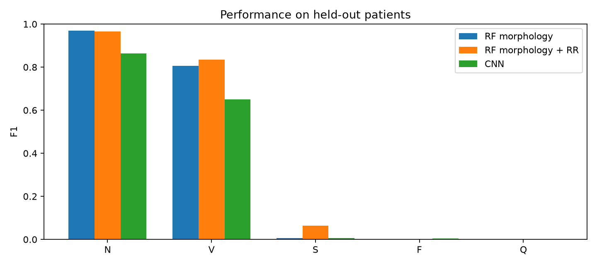
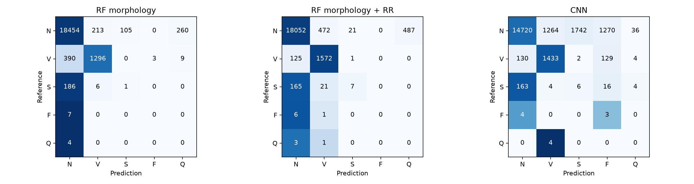
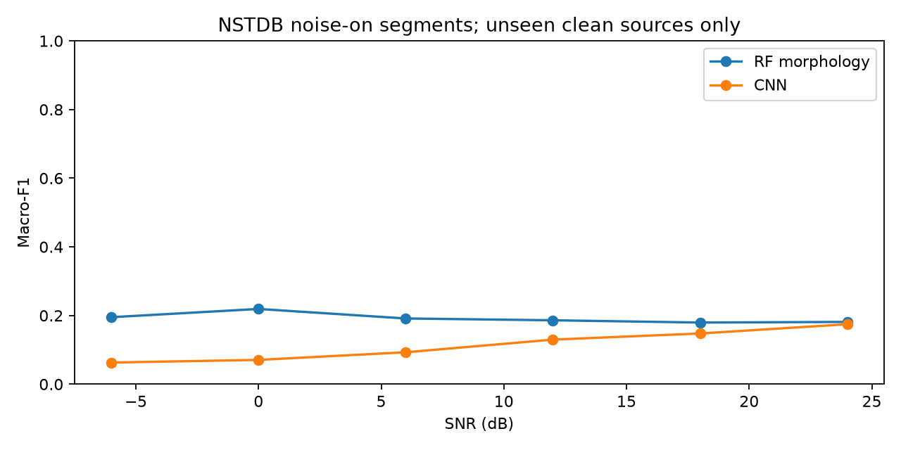

# Measured ECG research results — 8 November 2026

[Successful research run](https://github.com/eluan216/ecg-arrhythmia-detection/actions/runs/42501181042) · source commit `f42672ad6c1e1fbce168ead70a209aae7c515065` · [fixed environment](../../../constraints-research.txt)

## MIT-BIH development holdout

All 45 declared records; 82,007 training and 20,934 test beats. The outer test set contains nine subjects. CNN epoch selection uses only inner validation subjects, followed by refitting on all outer training subjects.

| Model | Macro-F1 | 95% patient bootstrap interval | Accuracy | Training seconds | Batch ms/beat |
| --- | --- | --- | --- | --- | --- |
| RF morphology | 35.66% | 29.97%–38.13% | 94.35% | 85.0 | 0.302 |
| RF morphology + RR | 37.28% | 32.00%–42.74% | 93.78% | 94.8 | 0.299 |
| CNN | 30.52% | 22.45%–35.90% | 77.20% | 328.4 | 0.093 |

The RR ablation improves the point estimate modestly, but the intervals overlap; this does not establish a statistically reliable or clinically useful gain. Both RF variants miss all F/Q test examples. The CNN identifies three of seven F examples but misses Q; rare-class performance remains weak. The CNN underperforms the RF despite validation-only epoch selection.

Timings include the scope documented in comparison.json. Batch ms/beat is throughput, not API latency. The shared float32 windows differ from the historical float64 RF path; keep this report separate from the 5 November baseline.

## Noise robustness

Only clean source 118 is evaluated; 119 is excluded because it appeared in training. Each SNR uses 987 noise-on beat centers: 942 N, 5 V and 40 S. Five-class macro-F1 includes zero-support F/Q classes. This one-source stress test cannot establish population-level robustness. High RF accuracy at severe noise largely reflects majority-N predictions.

## Frozen-model INCART evaluation

All 75 records were loaded. Lead II in physical mV is resampled from 257 to 360 Hz before reference-centered segmentation. No fitting or selection uses INCART labels. Repeated records share patients, so no record-as-patient uncertainty interval is claimed.

| Model | Macro-F1 | Accuracy |
| --- | --- | --- |
| RF morphology | 26.08% | 89.60% |
| CNN | 25.62% | 48.13% |

Accepted beats: **175,867**. Mapped annotations outside recording boundaries excluded: **7**. Original excluded locations and all record hashes are preserved in incart.json. These domain-shift results do not support clinical use.

## Reproduce and inspect

See [the experiment guide](../../../docs/experiments.md). The workflow artifact contains checksummed model weights, curated held-out explorer examples, core environment locks and reports (30-day artifact retention). JSON reports and figures here provide durable measured evidence; source data and weights stay out of Git.

- [Comparison and full provenance](comparison.json)
- [Noise report](nstdb.json)
- [INCART report and annotation audit](incart.json)
- [Model card](../../../MODEL_CARD.md)
